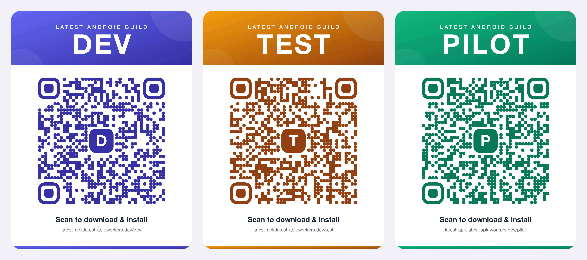

# Drive APK QR Installer

Printable QR codes that always download the **latest Android build** for an environment
(**Dev**, **Test**, **Pilot**) from a shared Google Drive folder.

Scan the code with an Android camera → the phone downloads the newest matching `.apk` →
the user taps **Install**. Upload a new build to Drive and the *same printed QR code* serves it
automatically — no need to regenerate or reprint anything.



---

## Table of contents

- [How it works](#how-it-works)
- [Project structure](#project-structure)
- [Live endpoints](#live-endpoints)
- [File naming rules](#file-naming-rules)
- [Setup from scratch](#setup-from-scratch)
- [Day-to-day usage](#day-to-day-usage)
- [Generating the QR codes](#generating-the-qr-codes)
- [What the user sees on Android](#what-the-user-sees-on-android)
- [Adding or renaming an environment](#adding-or-renaming-an-environment)
- [Troubleshooting](#troubleshooting)
- [Limitations](#limitations)
- [Security notes](#security-notes)

---

## How it works

A QR code can only hold a fixed URL, and Google Drive has no URL that means
"the newest file in this folder". A small **Cloudflare Worker** sits in between:

```
 ┌──────────┐   scan    ┌──────────────────────────────┐  list files   ┌──────────────────┐
 │ QR code  │ ────────▶ │ Cloudflare Worker            │ ────────────▶ │ Google Drive API │
 │ /dev     │           │ latest-apk.*.workers.dev/dev │ ◀──────────── │ (public folder)  │
 └──────────┘           └──────────────────────────────┘  newest first └──────────────────┘
                                       │
                                       │ 302 redirect to the newest "*dev*.apk"
                                       ▼
                         drive.usercontent.google.com/download?id=…  ──▶  APK download on the phone
```

1. The phone opens `https://latest-apk.latest-apk.workers.dev/<env>`.
2. The Worker asks the Drive API for every file in the folder, sorted by `modifiedTime` (newest first).
3. It picks the first file whose name ends in `.apk` and contains the environment word.
4. It responds with an HTTP **302 redirect** to that file's direct-download link.
5. Chrome downloads the APK; Android prompts the user to install it.

The folder must be shared as **"Anyone with the link"** — the Worker reads it with a Google API key,
not with a user login.

---

## Project structure

```
drive-apk-qr-installer/
├── latest-apk/                 Cloudflare Worker (the redirect service)
│   ├── src/index.js            Routing, Drive lookup, filename matching, redirect
│   ├── wrangler.jsonc          Worker name, entry point, FOLDER_ID variable
│   └── package.json            Wrangler dev dependency + scripts
│
└── qr-codes/                   Styled QR card generator
    ├── config.mjs              Base URL, environment labels and colours (edit this)
    ├── generate.mjs            Builds the SVG/PNG cards and the combined sheet
    ├── verify.mjs              Decodes every PNG and checks it points to the right URL
    ├── package.json            qrcode, sharp, jsqr + scripts
    └── out/                    Generated, print-ready output
        ├── dev.svg   dev.png
        ├── test.svg  test.png
        ├── pilot.svg pilot.png
        └── all.png             All three cards side by side
```

---

## Live endpoints

Base URL: **https://latest-apk.latest-apk.workers.dev**

| Path           | What it does                                                        |
|----------------|---------------------------------------------------------------------|
| `/`            | Plain-text list of available links                                  |
| `/dev`         | 302 → download the newest Dev APK                                   |
| `/test`        | 302 → download the newest Test APK                                  |
| `/pilot`       | 302 → download the newest Pilot APK                                 |
| `/dev/info`    | JSON describing the file `/dev` would serve (same for test / pilot) |

Example — check what the Dev QR will download right now:

```bash
curl https://latest-apk.latest-apk.workers.dev/dev/info
```

```json
{
  "environment": "dev",
  "name": "longevity-dev-release 18Nov 03.apk",
  "modifiedTime": "2026-11-19T10:56:43.669Z",
  "size": "173829275",
  "id": "…",
  "mimeType": "application/vnd.android.package-archive"
}
```

Responses and status codes:

| Status | Meaning                                                                    |
|--------|----------------------------------------------------------------------------|
| `302`  | Found a matching APK; redirecting to its download                          |
| `404`  | Unknown path, or no APK for that environment in the folder yet             |
| `500`  | Worker not configured (missing `GOOGLE_API_KEY` secret or `FOLDER_ID` var) |
| `502`  | Google Drive API unreachable or rejected the request                       |

All responses send `Cache-Control: no-store`, so a new upload is picked up immediately.

---

## File naming rules

A file is served for an environment when **both** are true:

1. The name ends with **`.apk`** (case-insensitive).
2. The name contains the environment word **as a separate token** — i.e. surrounded by
   non-alphanumeric characters (`-`, `_`, space, `.`, start/end of name).

Among all matching files, the one with the **latest modified time** wins.

| File name                                 | Dev | Test | Pilot | Why                        |
|-------------------------------------------|:---:|:----:|:-----:|----------------------------|
| `longevity-dev-release.apk`               | ✅  |      |       | `dev` is its own token     |
| `Copy of longevity-dev-release 18Nov.apk` | ✅  |      |       | Prefixes/suffixes are fine |
| `longevity-TEST-release_v2.apk`           |     | ✅   |       | Case-insensitive           |
| `longevity-pilot-release.apk`             |     |      | ✅    |                            |
| `longevity-device-build.apk`              |     |      |       | `device` ≠ `dev`           |
| `latest-build.apk`                        |     |      |       | `latest` ≠ `test`          |
| `longevity-dev-release.zip`               |     |      |       | Not an `.apk`              |
| `release-notes-dev.txt`                   |     |      |       | Not an `.apk`              |

> **Tip:** "Latest" means latest *modified* time in Drive. Re-uploading or editing an older
> file makes it the newest one again.

---

## Setup from scratch

You only need this to recreate the deployment (e.g. on another Cloudflare account).

### Prerequisites

- Node.js 18+ and npm
- A Cloudflare account (free plan is fine)
- A Google account with access to Google Cloud Console
- The Drive folder shared as **"Anyone with the link → Viewer"**

### 1. Create a Google API key

1. Open <https://console.cloud.google.com/> and create (or select) a project.
2. **APIs & Services → Library** → search **Google Drive API** → **Enable**.
3. **APIs & Services → Credentials → Create credentials → API key**.
4. Edit the key → **API restrictions → Restrict key** → tick only **Google Drive API** → **Save**.

Keep the key private — never commit it.

### 2. Configure the folder

The folder ID is the last part of the Drive folder URL:

```
https://drive.google.com/drive/folders/1bJfWAxnTtnhhyGxvKvCO6owmmPt3qiZ3
                                       └──────────── FOLDER_ID ─────────┘
```

Set it in [`latest-apk/wrangler.jsonc`](latest-apk/wrangler.jsonc) under `vars.FOLDER_ID`.
It is not a secret, so it lives in the config file.

### 3. Deploy the Worker

All commands run from the `latest-apk` folder. Wrangler is installed locally, so always prefix it with `npx`.

```bash
cd latest-apk
npm install
npx wrangler login                       # opens the browser to authorise Cloudflare
npx wrangler deploy                      # publishes the Worker, prints its URL
npx wrangler secret put GOOGLE_API_KEY   # paste the API key when prompted
```

> Running `wrangler` from another folder fails with *"Required Worker name missing"* — it
> needs `wrangler.jsonc` in the current directory.

The first deploy on a new account may ask you to register a `workers.dev` subdomain, and the
SSL certificate for a new subdomain can take a few minutes to become active.

### 4. Check it

```bash
curl https://<your-worker>.workers.dev/dev/info
```

If the base URL differs from the one in this README, update `BASE_URL` in
[`qr-codes/config.mjs`](qr-codes/config.mjs) and regenerate the QR codes.

---

## Day-to-day usage

**Publishing a new build:** upload the APK to the Drive folder with the environment word in its
name (e.g. `longevity-test-release.apk`). That's it — the printed QR code serves it immediately.

**Checking what a QR code serves:** open `/<env>/info` in a browser.

**Updating the Worker code:**

```bash
cd latest-apk
npx wrangler deploy
```

**Viewing live logs** (errors from the Drive API show up here):

```bash
cd latest-apk
npx wrangler tail
```

**Rotating the API key:** create a new key in Google Cloud, run
`npx wrangler secret put GOOGLE_API_KEY` again, then delete the old key. No redeploy needed.

---

## Generating the QR codes

The QR codes contain only the fixed Worker URLs, so you only regenerate them if you change the
base URL, add an environment, or want a different look.

```bash
cd qr-codes
npm install
npm run generate   # writes out/*.svg, out/*.png and out/all.png
npm run verify     # decodes each PNG at 3 sizes and checks the URL
```

Expected verify output:

```
✓ dev   @ full -> https://latest-apk.latest-apk.workers.dev/dev
✓ dev   @ 600  -> https://latest-apk.latest-apk.workers.dev/dev
✓ dev   @ 360  -> https://latest-apk.latest-apk.workers.dev/dev
…
All QR codes decode to the expected URLs.
```

### Design

Each card has:

- A gradient header band with **LATEST ANDROID BUILD** and the environment word in large type
- The QR code drawn in the environment's colour, with rounded modules and rounded finder eyes
- A centre badge with the environment's initial (**D** / **T** / **P**)
- "Scan to download & install" and the short URL as a fallback for manual entry

| Environment | Colour            |
|-------------|-------------------|
| Dev         | Indigo `#3730A3`  |
| Test        | Amber `#92400E`   |
| Pilot       | Emerald `#047857` |

Scan-reliability choices (keep these if you restyle):

- **Error correction level H** (30%) so the centre badge doesn't break decoding.
- **Modules touch their neighbours.** Round dots or gaps between modules made some
  decoders fail at high resolution.
- **Dark module colours on white.** Light colours (e.g. bright amber) reduce contrast,
  especially when printed.
- **Quiet zone** of white space around the code is preserved.

Always run `npm run verify` after changing the design, and test-scan a printed copy.

### Printing

- Use the **SVG** files for print shops or large formats — they scale without quality loss.
- PNGs are 2000 × 2640 px, good for printing up to roughly A5 at 300 dpi.
- Keep the printed QR at least **3 × 3 cm** so phones focus easily.

---

## What the user sees on Android

1. Open the **Camera** (or Google Lens) and point it at the code → tap the link.
2. Chrome downloads the APK. Chrome may warn *"This type of file can harm your device"* → **Download anyway**.
3. Tap the downloaded file (or the notification).
4. **First time only:** Android asks to allow installs from Chrome →
   **Settings → Allow from this source** → back.
5. Tap **Install** (or **Update** if an older build is installed).

Android never installs apps silently — the user always confirms. Fully automatic installs are
only possible with device management (MDM / Android Enterprise) or the Play Store.

---

## Adding or renaming an environment

1. Add the key in the Worker, [`latest-apk/src/index.js`](latest-apk/src/index.js):

   ```js
   const ENVIRONMENTS = Object.freeze({
     dev: "dev",
     test: "test",
     pilot: "pilot",
     uat: "uat",          // new: matches "*uat*.apk", served at /uat
   });
   ```

   The key is the URL path; the value is the word searched for in file names.

2. Deploy: `cd latest-apk && npx wrangler deploy`
3. Add the card style in [`qr-codes/config.mjs`](qr-codes/config.mjs):

   ```js
   uat: { label: "UAT", color: "#EC4899", colorDark: "#9D174D" },
   ```

4. Regenerate and verify: `cd qr-codes && npm run generate && npm run verify`

Keep the environment keys identical in both files.

---

## Troubleshooting

| Symptom | Cause / fix |
|---------|-------------|
| `zsh: command not found: wrangler` | Wrangler is a local dependency — use `npx wrangler …` inside `latest-apk/`. |
| `Required Worker name missing` | You're not in the `latest-apk/` folder. `cd latest-apk` first. |
| `Server is not configured.` (500) | The `GOOGLE_API_KEY` secret isn't set. Run `npx wrangler secret put GOOGLE_API_KEY`. |
| `Could not reach Google Drive` (502) | API key invalid/restricted wrongly, Drive API not enabled, or folder not public. Run `npx wrangler tail` and retry to see the Drive error. |
| `No TEST APK found in the folder yet.` (404) | No file matches the [naming rules](#file-naming-rules). Check `/test/info` and the file name. |
| Wrong build is served | "Latest" = latest **modified** time. Check `/<env>/info`; an older file may have been edited/re-uploaded. |
| SSL / handshake error right after first deploy | New `workers.dev` certificates take a few minutes. Wait and retry. |
| Drive shows "can't scan for viruses" page | Large files trigger this; the Worker adds `confirm=t` to skip it. If it still appears, the file may be flagged — re-upload it. |
| "App not installed" on the phone | The new APK is signed with a different key or has a lower `versionCode` than the installed app. Uninstall first or fix the build. |
| Camera doesn't react to the QR | Print larger, improve lighting, or try Google Lens. Run `npm run verify` to rule out a generation issue. |

---

## Limitations

- **Install always needs a tap.** Android requires user confirmation for sideloaded apps.
- **Folder size:** the Worker checks the 1,000 most recently modified files in the folder.
  Archive old builds into a subfolder if you exceed that (subfolders are not searched).
- **Drive quotas:** very heavy download traffic on one file can hit Google's download limits
  temporarily.
- **Workers free plan:** 100,000 requests/day — far more than QR scans will need.
- **Matching is by name only.** Anyone who can upload to the folder controls what the QR serves.

---

## Security notes

- The **Google API key** is stored as an encrypted Cloudflare secret, never in the code or repo.
  Restrict it to the Google Drive API only.
- The **folder ID** is not secret, but the folder is public: anyone with the link (or the QR)
  can download the builds. Don't put sensitive builds or files in it.
- Restrict **write access** to the Drive folder to people you trust — whoever can upload a
  correctly named `.apk` decides what every QR code installs.
- APKs installed this way bypass Play Protect's store review; only distribute builds signed
  with your release/debug keys.
